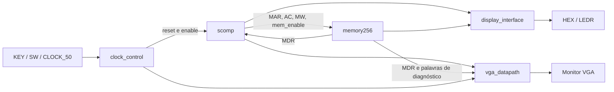
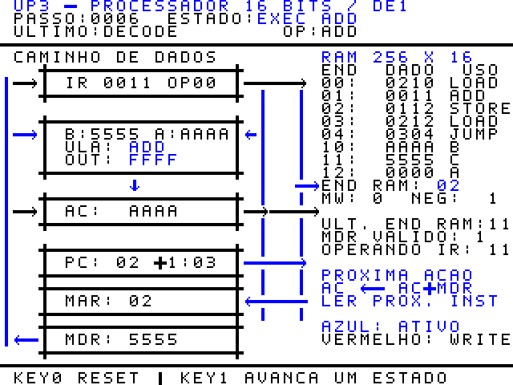

# Processador de 16 bits µP3 em FPGA com interface VGA

Projeto de Sistemas Digitais — Engenharia de Computação, UFSCar (2026). O processador foi implementado na Terasic DE1 (Cyclone II EP2C20F484C7), utilizando Quartus II 13.0 SP1. A interface VGA apresenta o caminho de dados e os valores dos registradores durante a execução manual.

## Organização do projeto

Os 37 arquivos do pacote [UP3_DE1_VGA_Quartus13.zip](UP3_DE1_VGA_Quartus13.zip) estão disponíveis individualmente em [projeto/](projeto/), com conteúdo original preservado.

| Arquivo | Função |
|---|---|
| [de1_top.qpf](projeto/de1_top.qpf) | Projeto do Quartus |
| [de1_top.bdf](projeto/de1_top.bdf) | Integração dos cinco blocos |
| [de1_top.qsf](projeto/de1_top.qsf), [de1_top.sdc](projeto/de1_top.sdc) | Pinagem e temporização |
| [clock_control.v](projeto/clock_control.v) | Sincronização dos comandos e avanço manual |
| [scomp.v](projeto/scomp.v) | Unidade de controle e caminho de dados |
| [memory256.v](projeto/memory256.v) | RAM de duas portas, 256 palavras de 16 bits |
| [display_interface.v](projeto/display_interface.v) | Displays e LEDs |
| [vga_datapath.v](projeto/vga_datapath.v) | Transferência das informações para o domínio de vídeo |
| [VGA_SYNC.vhd](projeto/VGA_SYNC.vhd), [Video_PLL.vhd](projeto/Video_PLL.vhd) | Sincronismo e clock VGA |
| [datapath_renderer.v](projeto/datapath_renderer.v), [font8.v](projeto/font8.v), [tela.hex](projeto/tela.hex) | Representação gráfica |
| [program.mif](projeto/program.mif), [program.hex](projeto/program.hex) | Programa e dados |
| [LEIA-ME.md](projeto/LEIA-ME.md) | Guia detalhado da implementação |

## Arquitetura

A CPU opera com palavras de 16 bits e endereços de 8 bits. A instrução é dividida em opcode e endereço. A porta A da RAM é utilizada pela CPU; a porta B é destinada à leitura de diagnóstico dos endereços 00–04 e 10–12. A leitura de vídeo não avança a CPU.

| Opcode | Instrução | Operação |
|---|---|---|
| 00 | ADD | AC recebe AC + M[endereço] |
| 01 | STORE | M[endereço] recebe AC |
| 02 | LOAD | AC recebe M[endereço] |
| 03 | JUMP | PC recebe o endereço |
| 04 | JNEG | Desvio se AC[15] = 1 |
| Outros | NOP | Mantém o acumulador |

## Programa da prática

| Endereço (hex) | Palavra | Função |
|---|---|---|
| 00 | 0210 | LOAD 10 |
| 01 | 0011 | ADD 11 |
| 02 | 0112 | STORE 12 |
| 03 | 0212 | LOAD 12 |
| 04 | 0304 | JUMP 04 |
| 10 | AAAA | B |
| 11 | 5555 | C |
| 12 | 0000 | A inicial |

O programa calcula AAAA + 5555 = FFFF, grava o resultado no endereço 12, lê esse valor e permanece no laço iniciado no endereço 04.

## Controles

| Entrada/saída | Função |
|---|---|
| KEY0 | Reset da CPU (não apaga a RAM) |
| KEY1 | Avança um estado por pressionamento |
| SW2/SW1 = 00 | AC nos displays |
| SW2/SW1 = 01 | IR nos displays |
| SW2/SW1 = 10 | MDR nos displays |
| SW2/SW1 = 11 | PC e MAR nos displays |
| LEDR[7:0] | PC |
| LEDR[8] | MW |

## Interface VGA

A PLL produz o clock de pixel de 25 MHz. O sincronizador gera vídeo de 640 × 480, com taxa nominal próxima de 60 Hz. A transferência dos dados para o domínio de vídeo ocorre por handshake; a imagem é atualizada no intervalo de apagamento vertical. Os registradores e as palavras da memória aparecem simultaneamente na tela. As setas azuis destacam os caminhos relacionados ao estado e o vermelho indica a escrita preparada.

A imagem acima é uma prévia gerada pelo mapa de caracteres, não uma fotografia do monitor. Os valores da tabela são obtidos da RAM. Consulte [LEIA-ME.md](projeto/LEIA-ME.md) para a interpretação de cada campo.

## Abrir e programar

1. Abra [projeto/de1_top.qpf](projeto/de1_top.qpf) no Quartus II 13.0 SP1, mantendo os arquivos juntos.
2. Confira o dispositivo EP2C20F484C7, o esquemático de1_top.bdf e a pinagem.
3. Execute Processing > Start Compilation. O pacote não contém SOF pré-compilado.
4. Conecte o monitor VGA e USB-Blaster à DE1. Em Tools > Programmer, selecione JTAG e o SOF gerado.
5. Pressione KEY0 e avance a execução com KEY1. O reset não restaura o conteúdo inicial da RAM; uma nova programação restaura o MIF.

## Verificação

A partir de `projeto/`, execute `python verificar_vga.py` para conferir o programa, o modelo de referência, a pinagem e o mapa de caracteres. Os testbenches [tb_scomp.v](projeto/tb_scomp.v), [tb_manual.v](projeto/tb_manual.v) e [tb_vga.v](projeto/tb_vga.v) podem ser executados com a memória comportamental. Os scripts ModelSim estão na mesma pasta, incluindo [sim_vga.do](projeto/sim_vga.do) e [sim_vga_ram_real.do](projeto/sim_vga_ram_real.do). A validação comportamental não substitui a compilação física no Quartus.

## Referências

- [Enunciado da prática](Pr%C3%A1tica.pdf).
- [Rapid Prototyping of Digital Systems: SOPC Edition](edddd8fa848a6ff8f0353f0b4be07d11.pdf), capítulo 9.
